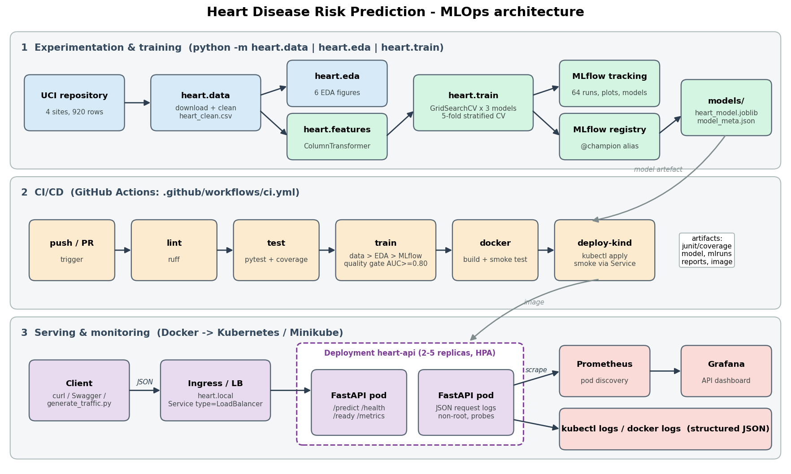

# Heart Disease Risk Prediction — End-to-End MLOps

**AIMLCZG523 Machine Learning Operations — Assignment 01**

A reproducible ML system that predicts the presence of heart disease from 13 clinical
features (UCI Heart Disease dataset). It covers data acquisition and EDA, tuned models
tracked in MLflow, a tested FastAPI service in Docker, a GitHub Actions CI/CD pipeline,
Kubernetes deployment, and Prometheus + Grafana monitoring.



| | |
|---|---|
| Data | all **4 UCI sites** (Cleveland, Hungary, Switzerland, VA) - 920 raw / 918 clean rows, real missingness |
| Champion | L1 logistic regression - **CV ROC-AUC 0.888 ± 0.050**, hold-out ROC-AUC 0.930, recall 0.892 |
| Tracking | MLflow (SQLite backend) - 64 runs, nested per-candidate runs, model registry `@champion` |
| API | FastAPI `/predict`, `/predict/batch`, `/health`, `/ready`, `/model-info`, `/metrics` |
| Tests | 34 pytest tests, 91 % coverage, ruff lint |
| Deploy | Docker image, K8s Deployment + LoadBalancer Service + Ingress + HPA, Prometheus + Grafana |

---

## 1. Quick start — run everything in the lab

Requirements: Python 3.10-3.12, Docker, internet access (for the UCI download, image pulls,
and to auto-install `kubectl`/`minikube` into `~/.local/bin` if they are missing).

```bash
git clone <repo-url> heart-disease-mlops && cd heart-disease-mlops
bash scripts/lab_run.sh all
```

`all` runs these stages; each one can also be run on its own (`bash scripts/lab_run.sh train test`), and each
writes its output to `logs/<stage>.log`:

| stage | what it does | evidence produced |
|---|---|---|
| `setup` | `python -m venv .venv` + `pip install -r requirements.txt` | `logs/pip-freeze.txt` |
| `data` | download the 4 UCI files, clean | `data/processed/heart_clean.csv` |
| `eda` | 6 EDA figures | `reports/figures/eda/*.png` |
| `train` | GridSearchCV for 3 model families, MLflow logging, registry | `mlflow.db`, `mlruns/`, `models/` |
| `test` | ruff + pytest + coverage | `logs/junit.xml` |
| `nb` | executes the 3 notebooks | `notebooks/*.ipynb` |
| `mlflow` | MLflow UI on **:5000** | screenshots |
| `docker` | build image, run container, smoke test (9 checks), show logs | image `heart-disease-api:1.0.0` |
| `k8s` | minikube start, image load, deploy API + Prometheus + Grafana, smoke test through the Service | port-forwards :8080 / :9090 / :3000 |
| `traffic` | 300 realistic requests (5 % invalid) so the dashboards have data | Grafana panels |
| `compose` | *(alternative to k8s)* API + Prometheus + Grafana via docker compose | :8000 / :9090 / :3000 |
| `clean` | stop port-forwards, compose, MLflow UI | |

### Windows (no Docker)

```powershell
python -m venv .venv; .venv\Scripts\activate
pip install -r requirements.txt
python -m heart.data; python -m heart.eda; python -m heart.train
pytest; ruff check .
uvicorn heart.serving:app --port 8000          # http://localhost:8000/docs
mlflow ui --backend-store-uri sqlite:///mlflow.db
```

Git-Bash can run `bash scripts/lab_run.sh setup data eda train test`.

---

## 2. Repository layout

```
├── src/heart/              # installable package (pip install -e .)
│   ├── config.py           # paths, schema, feature groups
│   ├── data.py             # download + clean        (python -m heart.data)
│   ├── eda.py              # EDA figures             (python -m heart.eda)
│   ├── features.py         # sklearn ColumnTransformer shared by train + serve
│   ├── train.py            # tuning, MLflow, registry (python -m heart.train)
│   ├── predict.py          # offline inference CLI   (python -m heart.predict file.json)
│   └── serving.py          # FastAPI app + Prometheus metrics + JSON logging
├── data/raw/               # original UCI files (downloaded)
├── data/processed/         # heart_clean.csv
├── notebooks/              # 01_eda, 02_model_training, 03_inference (executed)
├── tests/                  # pytest: data, features, model, API, training pipeline
├── models/                 # heart_model.joblib + model_meta.json (champion)
├── reports/                # figures, model_comparison.csv, eda_summary.csv, report docx
├── samples/                # example JSON requests
├── Dockerfile  .dockerignore  docker-compose.yml
├── k8s/                    # namespace, deployment, service (LB), ingress, HPA, kustomization
│   └── monitoring/         # Prometheus (k8s pod discovery + RBAC), Grafana
├── monitoring/             # prometheus.yml, alert rules, Grafana provisioning + dashboard JSON
├── .github/workflows/ci.yml
├── scripts/                # lab_run.sh, deploy_k8s.sh, smoke_test.sh, generate_traffic.py, ...
├── screenshots/            # evidence for the report
├── requirements.txt        # full env (train/test/notebooks), pinned
└── requirements-serve.txt  # slim runtime for the container
```

---

## 3. Data & EDA

* **Source**: `https://archive.ics.uci.edu/ml/machine-learning-databases/heart-disease/processed.{cleveland,hungarian,switzerland,va}.data`
  (downloaded by `python -m heart.data`; cached in `data/raw/`).
* **Cleaning** (`heart.data.clean`): `?` → NaN; `num` 0-4 → binary target; impossible zeros
  (`chol`, `trestbps`) → NaN; invalid category codes → NaN; 2 duplicates dropped.
* **Missingness is kept** and handled in the model pipeline (`ca` 66 %, `thal` 53 %, `slope` 33 %
  missing - mostly non-Cleveland sites). The `site` column is used for EDA only, never as a feature.
* Figures (`reports/figures/eda/`): class balance overall/by site, missingness heat-map by site,
  numeric histograms by class, disease rate per category level, Spearman correlation heat-map, box plots.

## 4. Features & models

| group | columns | transform |
|---|---|---|
| numeric | age, trestbps, chol, thalach, oldpeak, ca | median impute **+ missing indicator** → StandardScaler |
| binary | sex, fbs, exang | most-frequent impute |
| categorical | cp, restecg, slope, thal | missing → own level → one-hot (fixed category list) |

An ablation in notebook 02 shows the missing-indicator design raises CV ROC-AUC from 0.880 to 0.899.

Three families are tuned with `GridSearchCV` (5-fold stratified, refit on ROC-AUC, accuracy, precision, recall and F1 also logged).
The hold-out set (20 %) is used only for reporting. The champion is chosen by CV score.

| model | CV ROC-AUC | CV F1 | test ROC-AUC | test acc | test recall |
|---|---|---|---|---|---|
| **logistic regression** (L1, C=0.5) | **0.888** | 0.843 | 0.930 | 0.842 | 0.892 |
| random forest | 0.884 | 0.841 | 0.924 | 0.821 | 0.863 |
| hist gradient boosting | 0.878 | 0.832 | 0.919 | 0.859 | 0.931 |

## 5. Experiment tracking

`python -m heart.train` logs to `sqlite:///mlflow.db` (artifacts in `mlruns/`):

* one **parent run per model family**: best params, CV mean/std, hold-out metrics, fit time,
  confusion matrix / ROC / PR / feature-importance plots, CV results CSV, logged sklearn model with signature
* one **nested child run per grid candidate** (60 total) with its params and CV metrics
* a **champion-final** run: comparison ROC plot, comparison table, refit model registered as
  `heart-disease-classifier` with alias **`@champion`**

```bash
mlflow ui --backend-store-uri sqlite:///mlflow.db   # http://localhost:5000
```

## 6. API

```bash
curl -X POST http://localhost:8000/predict -H "Content-Type: application/json" \
     -d '{"age":58,"sex":1,"cp":4,"trestbps":140,"chol":289,"fbs":0,"restecg":2,
          "thalach":135,"exang":1,"oldpeak":1.8,"slope":2,"ca":1,"thal":7}'
# {"prediction":1,"label":"heart disease","confidence":0.9624,"probability_disease":0.9624,
#  "risk_band":"high","model_name":"logistic_regression","model_version":"1.0.0"}
```

* Pydantic validation with clinical ranges → **422** on bad input; optional fields may be omitted (imputed).
* Every request gets an `x-request-id` and a one-line **JSON log** (method, path, status, latency).
* `/metrics` exposes `heart_api_requests_total`, `heart_api_request_latency_seconds`,
  `heart_api_predictions_total{outcome}`, `heart_api_disease_probability`, `heart_api_model_loaded`.

## 7. Container

```bash
docker build -t heart-disease-api:1.0.0 .
docker run -d -p 8000:8000 --name heart-api heart-disease-api:1.0.0
bash scripts/smoke_test.sh http://localhost:8000
```
`python:3.12-slim`, serving-only dependencies, non-root user (uid 10001), `HEALTHCHECK` on `/health`, model baked into the image.

## 8. Kubernetes deployment (Minikube / Docker Desktop / cloud)

```bash
minikube start --driver=docker
minikube addons enable ingress && minikube addons enable metrics-server
minikube image load heart-disease-api:1.0.0
bash scripts/deploy_k8s.sh
kubectl -n heart-mlops get all,ingress,hpa

# access options
minikube service heart-api -n heart-mlops --url        # NodePort URL of the LoadBalancer service
minikube tunnel                                        # gives the LoadBalancer an EXTERNAL-IP
echo "$(minikube ip) heart.local" | sudo tee -a /etc/hosts && curl http://heart.local/health   # Ingress
kubectl -n heart-mlops port-forward svc/heart-api 8080:80                                       # port-forward
```

Manifests: 2 replicas with rolling updates (`maxUnavailable: 0`), startup/readiness/liveness probes,
resource requests/limits, read-only root FS, HPA 2→5 at 70 % CPU, Prometheus scrape annotations.

## 9. Monitoring

* **Prometheus** (k8s: `k8s/monitoring/prometheus.yaml`) discovers each API pod through the k8s API
  (RBAC-scoped service account) and scrapes `/metrics` every 10 s. Alert rules: API down, 5xx > 5 %,
  p95 latency > 500 ms, positive-prediction rate drift (`monitoring/alert_rules.yml`).
* **Grafana** is provisioned with the Prometheus datasource and the *Heart Disease API* dashboard
  (request rate, error rate, p50/p95/p99 latency, predictions by outcome, probability distribution, 4xx).
  `http://localhost:3000` - admin / admin.
* **Logs**: `kubectl -n heart-mlops logs -l app=heart-api` / `docker logs heart-api` - JSON lines.

## 10. CI/CD

`.github/workflows/ci.yml` - on every push / PR:

1. **lint** - `ruff check` (fails on any violation)
2. **test** - pytest + coverage, JUnit summary in the job summary, `test-reports` artifact
3. **train** - download → EDA → train with MLflow → quality gate (CV ROC-AUC ≥ 0.80) → artifacts
   `model`, `mlflow-tracking`, `reports`, plus a model-comparison table in the job summary
4. **docker** - build image with the freshly trained model, run it, smoke test, `docker-image` artifact
5. **deploy-kind** - spin up a kind cluster, load the image, apply the manifests, smoke test through the Service

Any failing step stops the pipeline and its log is kept in the run.

## 11. Reproducibility

* Pinned `requirements.txt` / `requirements-serve.txt`; `random_state=42` everywhere.
* Preprocessing is part of the persisted sklearn `Pipeline`, so the transformations used at serving time are exactly the ones used in training.
* `models/model_meta.json` records the MLflow run id, params, metrics and training timestamp of the served model.
